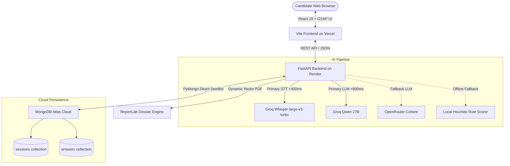

# 🚀 AI Interview Simulator & Assessor (HR Bot)

> **Autonomous Multimodal Technical & Behavioral Interview Evaluation Platform**  
> *Built for the DITE Hackathon 2026-27 (Denning Institute of Technology and Entrepreneurship)*

[](https://frontend-ivory-rho-39.vercel.app)
[](https://dite-hackathon-2026.onrender.com)
[](https://cloud.mongodb.com)
[](https://groq.com)

---

## 💡 The Problem
Traditional interview screening is slow, subjective, and cost-prohibitive. Candidates lack structured, objective feedback on technical competence, speech delivery (pacing, filler words), and composure.

## ✨ The Solution
**AI Interview Simulator** provides an end-to-end autonomous interview cockpit:
1. **Interactive Interview Cockpit**: Real-time role selection (Software Engineer, Product Manager, Data Scientist, HR).
2. **Multimodal Composure & Eye-Gaze Tracking**: Real-time reticle telemetry and composure scoring.
3. **Ultra-Low Latency Speech Transcription**: Groq Cloud Whisper (`whisper-large-v3-turbo`) transcribes answers in <400ms.
4. **Tiered Fault-Tolerant AI Evaluator**:
   - **Primary**: Groq `qwen/qwen3.8-27b` (sub-second structured rubric evaluation)
   - **Fallback**: OpenRouter `cohere/north-mini-code:free`
   - **Last Resort**: Deterministic Local Rule Engine (guarantees zero downtime even offline)
5. **Comprehensive Dossier & Analytics**:
   - 5-Axis Competency Radar Chart (Relevance, Completeness, Structure, Speech Clarity, Composure)
   - Model Answer comparisons and constructive improvement directives
   - Publication-grade PDF Dossier generation via ReportLab
   - Persistent cloud session storage via **MongoDB Atlas**

---

## 🏛️ System Architecture



---

## ⚡ Tech Stack

| Layer | Technologies |
|---|---|
| **Frontend** | React 19, TypeScript, Vite, Tailwind CSS v4, Zustand, Chart.js, GSAP |
| **Backend** | Python 3.11+, FastAPI, Uvicorn, Pydantic v2, ReportLab, PyMongo |
| **AI Models** | Groq (`qwen/qwen3.8-27b`, `whisper-large-v3-turbo`), OpenRouter (`cohere/north-mini-code:free`) |
| **Database** | MongoDB Atlas (Multi-host replica set, serverless pooling) with SQLite local dev fallback |
| **Hosting** | Vercel (Frontend SPA) + Render (FastAPI Cloud Container) |

---

## 🔑 Environment Variables

### Backend (`app/backend/.env` / Render Dashboard)

| Variable | Description | Example / Default |
|---|---|---|
| `DATABASE_URL` | MongoDB Atlas URI or SQLite path | `mongodb://...` |
| `GROQ_API_KEY` | Groq Cloud API key for ultra-fast inference | `gsk_...` |
| `GROQ_MODEL` | Primary LLM model identifier | `qwen/qwen3.8-27b` |
| `OPENROUTER_API_KEY` | OpenRouter API key for fallback inference | `sk-or-v1-...` |
| `OPENROUTER_MODEL` | Fallback LLM model identifier | `cohere/north-mini-code:free` |
| `OPENROUTER_FALLBACK_MODEL` | Offline heuristic tag | `local_heuristic` |
| `DEMO_MODE` | Seeds historical benchmark sessions | `true` |
| `WEIGHT_CONFIDENCE` | Composure scoring weight (30%) | `0.30` |
| `WEIGHT_CLARITY` | Speech clarity scoring weight (30%) | `0.30` |
| `WEIGHT_CONTENT` | Technical rubric scoring weight (40%) | `0.40` |

### Frontend (`app/frontend/.env` / Vercel Dashboard)

| Variable | Description | Example |
|---|---|---|
| `VITE_API_URL` | Live Render backend endpoint | `https://dite-hackathon-2026.onrender.com` |

---

## 🚀 Local Development Setup

### 1. Clone & Setup Workspace
```bash
git clone https://github.com/Jawad-larik/dite-hackathon-2026.git
cd dite-hackathon-2026
```

### 2. Start Backend
```bash
cd app/backend
pip install -r requirements.txt
python -m uvicorn app.main:app --host 127.0.0.1 --port 8000 --reload
```
*Backend API docs will be live at `http://127.0.0.1:8000/docs`.*

### 3. Start Frontend
```bash
cd ../frontend
npm install
npm run dev
```
*Frontend cockpit will be live at `http://localhost:5173`.*

---

## 🛡️ License
Built for the DITE Hackathon 2026-27.
